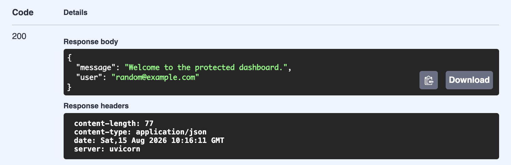

# Week4_Auth_and_Login

A minimal FastAPI project demonstrating authentication flows using Supabase Auth. This repository implements signup, login, and logout endpoints and protects example routes using a Bearer token verified with Supabase. It is intended as a learning exercise for backend authentication and token-based protection.

**Key points**
- Auth is handled by Supabase Auth (JWT access tokens).
- Protected routes validate the `Authorization: Bearer <token>` header against Supabase on each request.
- Logout calls Supabase's sign-out API but does not by itself immediately invalidate stateless JWTs on clients — see "Token invalidation" below.

## Motivation

Most auth tutorials stop at "log in, get a token." What they gloss over is what happens on *logout* — and that's exactly the gap this project was built to explore.

Supabase issues stateless JWTs: once signed, a token is valid until it expires, whether or not the server still "wants" it to be. Calling `sign_out()` tells Supabase you're done, but it doesn't retroactively revoke a token that's already out in the world — a client can keep using it until it naturally expires. That distinction (a session ending vs. a token being invalidated) doesn't show up until you actually build the flow and ask, "wait, is this token *really* dead right now?"

This repo is my attempt to work through that problem directly: implement the standard signup/login/logout flow, verify tokens against Supabase on protected routes, and document — rather than hide — the gap between "logged out" and "token invalidated," along with the mitigation strategies (blacklisting, short-lived tokens, admin revocation) for closing it.

## Quick Start

1. Clone the repo and enter the project folder.
2. Create a virtual environment and install dependencies:
   ```bash
   python -m venv venv
   source venv/bin/activate  # Windows: venv\Scripts\activate
   pip install -r requirements.txt
   ```
3. Copy `.env.example` to `.env` and fill in your Supabase project's URL and keys.
4. Run the server:
   ```bash
   uvicorn app:app --reload --host 0.0.0.0 --port 8000
   ```
5. Open `http://localhost:8000/docs` to try the endpoints interactively.

## Usage

Example flow using `curl`:

**1. Sign up**
```bash
curl -X POST http://localhost:8000/auth/signup \
  -H "Content-Type: application/json" \
  -d '{"email": "user@example.com", "password": "your-password"}'
```

**2. Log in** (returns an access token in the response's `session`)
```bash
curl -X POST http://localhost:8000/auth/login \
  -H "Content-Type: application/json" \
  -d '{"email": "user@example.com", "password": "your-password"}'
```

**3. Call a protected route** (use the access token from step 2)
```bash
curl http://localhost:8000/protected/dashboard \
  -H "Authorization: Bearer <access_token>"
```

**4. Log out**
```bash
curl -X POST http://localhost:8000/auth/logout \
  -H "Authorization: Bearer <access_token>"
```

Note: as described in "Token invalidation" below, the token from step 3 will still work even after step 4 until it naturally expires — that's expected behavior for stateless JWTs, not a bug.

## Token invalidation
Supabase issues stateless access tokens (JWTs). Calling `sign_out()` on the server notifies Supabase of the intent to end the session, but previously-issued JWTs remain valid until they expire unless you implement server-side revocation (for example, a token blacklist or using admin APIs with the service role key). This repo documents the behavior and provides examples of usual mitigation strategies.

## Prerequisites
- Python 3.10+
- A Supabase project (URL and API keys)
- Recommended: create a virtual environment and install dependencies from `requirements.txt`.

## Environment variables
Create a `.env` file at the project root (you can copy `.env.example`) and set the following keys:

- `SUPABASE_URL` — your Supabase project URL, for example `https://xyzcompany.supabase.co`
- `SUPABASE_PUBLISHABLE_KEY` — the client/publishable key used by the app (used here to initialize the Supabase client)
- `SUPABASE_ANON_KEY` — (optional) public anon key if you prefer to name it explicitly
- `SUPABASE_SERVICE_ROLE_KEY` — (optional, **sensitive**) service role key for admin operations (do NOT commit real values)
- `DATABASE_URL` — (optional) database connection string if you need DB access
- `SECRET_KEY` — (optional) application secret for signing cookies or other secrets

Important: Do not commit any real secret values. Use `.env.example` as a template and keep real values out of version control.

## One command to run
From the project root (after installing dependencies and configuring `.env`):

```bash
uvicorn app:app --reload --host 0.0.0.0 --port 8000
```

After the server starts, the interactive Swagger UI is available at `http://localhost:8000/docs` and Redoc at `http://localhost:8000/redoc`.

## API reference (selected endpoints)

| Endpoint | Method | Description | Auth required |
|---|---:|---|---:|
| `/auth/signup` | POST | Create a new user. Request body: `{ "email": "...", "password": "..." }` | No |
| `/auth/login` | POST | Sign in a user. Request body: `{ "email": "...", "password": "..." }` — returns `user` and `session` | No |
| `/auth/logout` | POST | Logout the current user. Requires `Authorization: Bearer <access_token>` header. | Yes |
| `/protected/dashboard` | GET | Example protected resource — returns user info when token valid. Requires Bearer token. | Yes |
| `/public/info` | GET | Public information endpoint (no authentication). | No |

Notes:
- Protected endpoints use the `get_access_token` dependency which validates the Bearer token with Supabase and returns the authenticated user. If the token is invalid or expired the endpoint responds `401`.

## Swagger / API docs screenshot
FastAPI exposes an interactive Swagger UI at `/docs`. To add a screenshot to this repository for documentation:

1. Run the server locally (see "One command to run").
2. Open `http://localhost:8000/docs` in your browser.
3. Take a screenshot and save it to `docs/swagger_screenshot.png`.
4. Commit the screenshot if you want it included in the repo.

Example commit message when adding the screenshot:

```bash
git add docs/swagger_screenshot.png
git commit -m "Add Swagger UI screenshot"
```

## Development notes & next steps
- If you need immediate token revocation on logout, implement a server-side blacklist (Redis or DB) or perform admin revocation using `SUPABASE_SERVICE_ROLE_KEY` where supported.
- For production, ensure HTTPS, limit token lifetimes, and store service keys securely (e.g. secrets manager).

## License
This project is provided as-is for educational purposes. Add a license file if you intend to publish or reuse this code in other projects.

## Documentation




## Contributing

This is a personal learning project built to explore backend authentication and JWT behavior — it isn't currently set up to accept outside contributions. Feel free to fork it and adapt it for your own learning, though.
